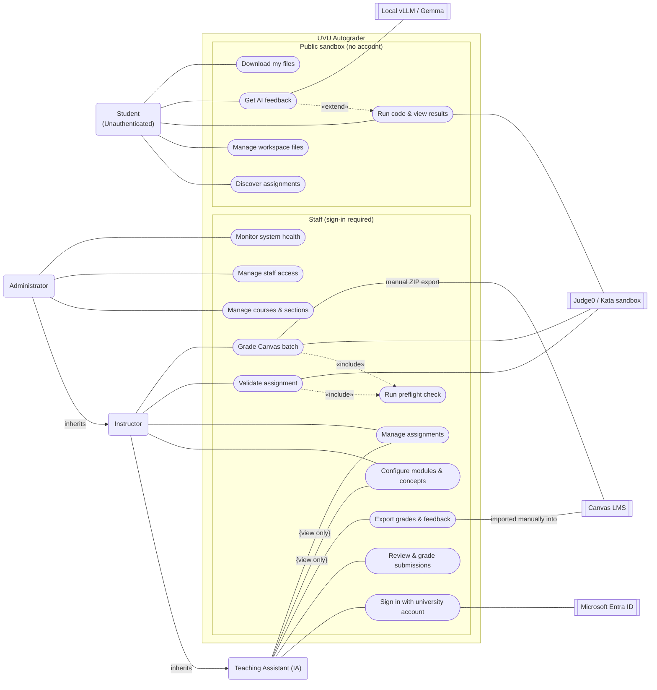

## Legend

| Symbol | Meaning |
| --- | --- |
| Rounded box | **Actor**: a person who uses the system |
| Oval | **Use case**: a goal an actor achieves with the system |
| Double-bordered box | **External system** (secondary actor) that takes part in a use case |
| Solid line | **Association**: the actor or external system takes part in the use case |
| Solid line with `{…}` | **Constrained association**: the actor takes part with the stated restriction |
| Solid arrow labelled `inherits` | **Generalisation**: the actor can do everything the target actor can, plus its own use cases |
| Dashed arrow labelled `«include»` | **Include**: the source use case always performs the target use case |
| Dashed arrow labelled `«extend»` | **Extend**: the source use case optionally adds behaviour to the target use case |
